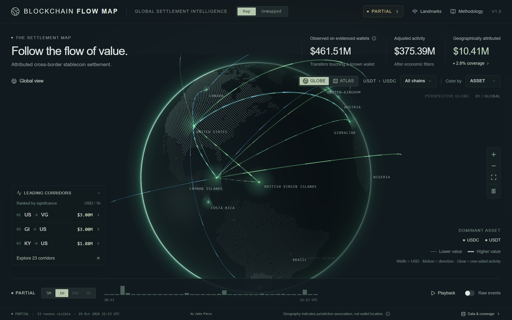
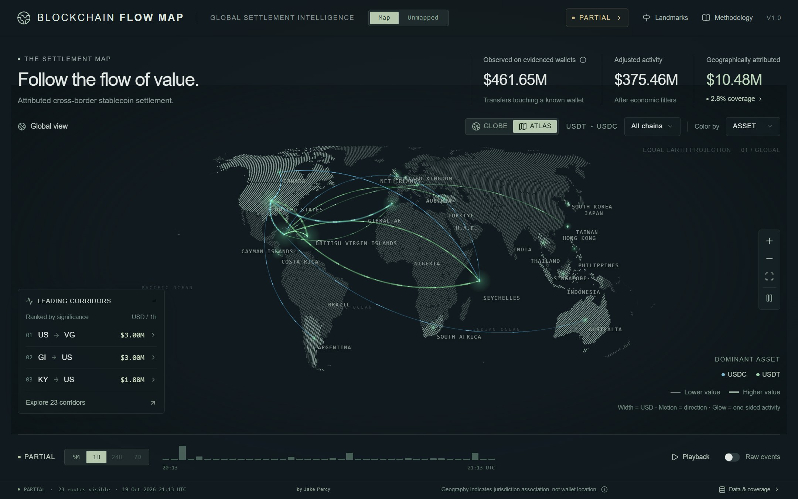
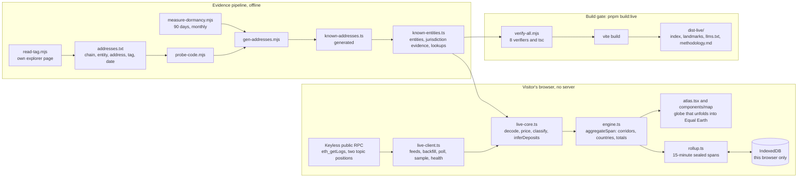

# Blockchain Flow Map

<p>
  <a href="docs/images/live-globe.jpg"></a>
  <a href="docs/images/live-atlas.jpg"></a>
</p>

*The live page on 19 October 2026 at 21:13 UTC, 1H window, on the globe and unfolded into the Equal Earth atlas. The
routes are what that hour's evidenced wallets showed, not a standing claim; the page read PARTIAL because Avalanche's
public endpoint was rate-limiting.*

[](https://github.com/jakeperc/blockchain-flow-map/actions/workflows/verify.yml)
[](LICENSE)

**Live:** [jakepercy.com/global-blockchain-flow](https://jakepercy.com/global-blockchain-flow/) ·
[Landmarks](https://jakepercy.com/global-blockchain-flow/landmarks.html) ·
[llms.txt](https://jakepercy.com/global-blockchain-flow/llms.txt) ·
[methodology](https://jakepercy.com/global-blockchain-flow/methodology.md)

**Built from `main` on every push:** [jakeperc.github.io/blockchain-flow-map](https://jakeperc.github.io/blockchain-flow-map/) (GitHub Pages, the same
gated build)

A live, evidence-only map of cross-border stablecoin settlement. The visitor's browser reads USDC and USDT
`Transfer` logs straight from free public RPC endpoints on seven chains (Ethereum, Base, Arbitrum, Avalanche, Polygon,
Optimism, Tron), attributes each transfer against a registry of exchange and custodian wallets whose evidence is a
public name tag on the address's own explorer page plus a regulator or company document for the operator's
jurisdiction, and draws a route only when both ends of a transfer are evidenced wallets in different jurisdictions.
There is no server, no database and no API key: a static folder, uploaded by FTP to jakepercy.com and published to
GitHub Pages by CI. The map deliberately shows only a
small fraction of on-chain volume and says exactly how small.

## What you are looking at

- **Three headline figures.** *Observed on evidenced wallets* (every priced transfer touching a registry wallet),
  *Adjusted activity* (after mint/burn, bridge, same-entity, treasury and bot transfers are removed) and
  *Geographically attributed* (the share of adjusted value that could be placed at both ends, in different
  jurisdictions). The coverage percentage beside the third figure is the honest number: usually single digits.
- **The drawing rule.** "A route is drawn only when both ends of a transfer are publicly evidenced wallets in
  different jurisdictions. Most transfers are not, by design." A glow at a jurisdiction is one-sided evidenced
  activity, never a route.
- **Windows.** 5M and 1H come from transfers held in memory. 24H and 7D are assembled from every completed
  quarter-hour the visitor's own browser has watched, sealed into exact accounting and kept in that browser alone;
  they unlock once 80% of the window has been observed. Nothing is uploaded, shared or scaled up.
- **Why is this mapped here?** Every corridor opens into evidence cards: the entity, the explorer tag, the
  jurisdiction document, the date each was last verified, and whether the endpoint is a first-party label, a
  DERIVED cross-chain reuse of an Ethereum label, or an INFERRED deposit address seen sweeping into a labelled wallet.
- **Unmapped.** The transfers the map cannot place, who they touched, and the largest unplaced counterparties as a
  research lead list, never as evidence.
- **Landmarks.** A second, static page: sixteen landmark transactions read from their own chains by two or three
  independent endpoints that must agree, named only under a written rule, with every figure stamped from chain data.

## The rules it refuses to break

1. An address enters the registry only when its own explorer page shows a public name tag, stored verbatim with the
   date it was read. Researcher compilations, analytics firms, exchange-published lists and memory are not evidence.
2. A jurisdiction comes from a regulator register, a court filing or the company's own legal document, and must name
   one legal entity that holds customer crypto whatever the client's residence (the operator test). Ten brands with
   clean tags were removed when their own documents failed it.
3. Deposit addresses, funders, routers, bridges, DEX and token contracts and issuer treasuries never enter the registry.
4. No CAPTCHA is bypassed and no rate limit worked around; an explorer that blocks a page is read another lawful way
   or the address is skipped.
5. Evidence expires. The model refuses evidence older than 180 days at the transfer's own time, and the build fails
   60 days before the earliest expiry so a published page cannot go stale in public.
6. Derived evidence is second class: never VERIFIED, never for a contract, never the anchor of an inference.
7. The observed total is a declared sample, never an estimate. A small unfiltered slice of chain time is read
   periodically to state how small the evidenced share is, and is never scaled up.
8. No synthetic data, ever. When a feed fails the page shows LOADING, PARTIAL, DELAYED or RECONNECTING; it never
   falls back to a placeholder.

## Decisions

Each one is written up with the measured evidence and the condition under which it would be reopened, in
[docs/DECISIONS-2026-09.md](docs/DECISIONS-2026-09.md).

| | Decided | Decision | Consequence |
|---|---|---|---|
| D1 | 2026-09-21 | An exchange's own published address list is not evidence. | Explorer tags stay the only way in. |
| D2 | 2026-09-21 | Wallets with no stablecoin transfer in 90 days leave the live filter but stay as evidence. | Visitor upload for the first hour fell about 89%; replayed hours identical. |
| D3 | 2026-09-21 | The operator test: one legal entity, one jurisdiction, whatever the client's residence. | FalconX, Copper, BitGo, Cumberland, Galaxy, Jump, B2C2, GSR, Zero Hash and Amber Group removed. |
| D4 | 2026-09-25 | A token is read only where its issuer publishes the contract. | BNB Chain absent (bridge-issued pegs); Polygon and Optimism USDC only; Tron USDT only. |
| D5 | 2026-09-25 | A 24H or 7D figure is what this browser recorded, in sealed quarter-hours, offered at 80% coverage. | Recorded history, measured coverage, real baselines; no per-transfer detail stored. |
| D6 | 2026-09-29 | Tronscan's own public name tags are admissible for Tron, like Etherscan's. | Tron live with 27 tagged wallets; nothing derives onto Tron. |
| D7 | 2026-10-02 | Who the Landmarks page may name: an explorer tag crediting no outside source, or a primary document identifying the transaction. | News and analytics firms never name anyone there; a person only on their own statement or a court record. |

## How it works



The pure parts (`lib/atlas/live-core.ts`, `engine.ts`, `rollup.ts`, `model.ts`) have no fetch, DOM or timers and are
exercised by the verifiers in plain Node. The transport and state machine (`live-client.ts`) rotates endpoints,
counts failed chunks as partial coverage rather than swallowing them, and re-reads the latest hour after a sleep.

## Quickstart

Node 22.18 or newer (the build-time renderers import TypeScript from plain modules).

```bash
corepack enable && pnpm install
```

```bash
pnpm dev:live
```

```bash
pnpm verify && pnpm typecheck && pnpm build:live
```

`pnpm build:live` refuses to build if any verifier fails, including when the evidence registry would expire within
60 days or the dormancy measurement is older than 45 days. `node scripts/serve-dist.cjs dist-live` serves the build
under a nested path the way the FTP folder does.

## The evidence pipeline, in five steps

1. **Lead.** A candidate wallet comes from an activity measurement (the largest unlabelled counterparties of
   evidenced wallets), a holder export, or a lead feed. A lead is never evidence.
2. **Tag.** `scripts/registry/read-tag.mjs` reads the address's own explorer page and prints the tag verbatim, with
   any "tagged based on a compilation" disclosure, which goes into the row's note.
3. **Operator.** The brand's own documents must name one legal entity, in one jurisdiction, that holds customer
   crypto for every client. If custody depends on the client's residence, the brand stays out, however active.
4. **Activity.** A tagged wallet is admitted only if it moved at least $100k in the screening window; a documented
   operator whose wallets moved nothing in 90 days is recorded as such and left out.
5. **Gate.** `gen-addresses.mjs` refuses orphans (a contract on Ethereum with no code on another chain), the
   verifiers check every row resolves and every date is real, and the build stamps the registry's size and freshness
   into `llms.txt` and the page.

## What it costs a visitor

Measured, with the report each figure comes from:

| | Figure | Measured | Source |
|---|---|---|---|
| One hour on Ethereum, Base and Arbitrum, filtered feed | 4.1 MB down, 2.1 MB up | 2026-09-20 | docs/LIVE-FEED.md |
| The same, unfiltered | about 140 MB | 2026-09-20 | docs/LIVE-FEED.md |
| Upload for the backfilled hour after the dormant tier | 2.2 MB to 0.23 MB | 2026-09-21 | docs/measurements/2026-09-21/dormancy.md |
| One hour of the Tron feed, 21 wallets | 1.24 MB on the wire | 2026-10-07 | docs/measurements/2026-10-06/tron-tronscan-tags.md |
| Endpoint caps that bind the filter | 1,000 addresses per topic (Ethereum), 997 (Arbitrum) | 2026-09-21 | docs/LIVE-FEED.md, `lib/atlas/feeds.ts` |

## Who did what

The rules, the seven decisions, every admission and removal, the holder exports, the bandwidth and budget calls and
the phone-layout calls were Jake Percy's. The code was written with AI coding agents working under
[AGENTS.md](AGENTS.md) and [CLAUDE.md](CLAUDE.md): a standard they could not relax, enforced by the build gate rather
than by trust. Each change was also recorded in an engineering log kept with the project but not published; the
facts the public documents rely on are in `docs/`: the method, the decisions, the live feed's measured limits and the
dated measurement reports.

## Maintenance

- The dormancy measurement is redone monthly (`scripts/registry/measure-dormancy.mjs`, about 100 minutes on free
  endpoints); the build fails once it is older than 45 days. Last measured 2026-10-07.
- The Landmarks "recent" window moves monthly (`scripts/landmarks/README.md`).
- Evidence is re-verified before it ages out: the earliest current expiry is 2027-03-17 and the gate starts failing
  60 days before it.

## Status

Updated 2026-10-20. Seven chains live; 1,217 first-party wallets (plus 3,572 derived) across 68 entities and 30
jurisdictions; Solana not connected (it needs a keyed indexer). The repository was prepared for publication on
2026-10-18 and went public on 2026-10-19: the deferred backend scaffold and the unused template code left the tree,
the gate type-checks the whole project, the page's first minute reads honestly, both pages name and link their
author and the source, the 1H window has corridor baselines, and the bulk explorer-scan outputs are kept offline. On 2026-10-19 a pinch on the flat map could fling it off a phone's screen; that is fixed, and the flat map opens on the whole world. Since 2026-10-19 every push to `main` also publishes the map to GitHub Pages through the same gated build. The screenshots above are dated captures of the live page, and the projection caption no longer sits under the map legend on desktop. On 2026-10-20 the health badge, which a 375 px phone clipped at the right edge of the top bar, leaves the top bar on phones (the time strip and status strip still show it), and the headline figures were re-measured at 375 px: three columns, nothing overlapping.
jakepercy.com is published by hand from `dist-live/`, the output of `pnpm build:live`. The project was formerly Ledger Atlas;
some file names and the browser's history store still carry that name.

## Repository map

| Path | What it is |
|---|---|
| `live-lite/` | The two pages' entries, styles and the `llms.txt` prose template |
| `components/atlas.tsx`, `components/map/` | The UI and the globe renderer |
| `lib/atlas/` | Model, accounting, live client, sealed history, registry, geography |
| `scripts/registry/` | The evidence pipeline: source list, tag reader, code probe, dormancy scan, generator |
| `scripts/verify-*.{cjs,mjs}`, `scripts/verify-all.mjs` | The build gate |
| `scripts/landmarks/`, `lib/landmarks/` | The Landmarks page pipeline and its generated data |
| `scripts/llms/` | `llms.txt`, `methodology.md` and the page's plain-text surfaces |
| `scripts/measure-*.mjs`, `scripts/screen-candidate-chain.mjs` | Offline diagnostics that rank work by measured activity |
| `docs/` | Methodology, decisions, the live feed and its measured limits, API plan, measurement reports |
| `AGENTS.md`, `CLAUDE.md` | The standing instructions the AI coding agents work under |

See [NOTICE](NOTICE) for the terms on the evidence registry and the measurement reports.
